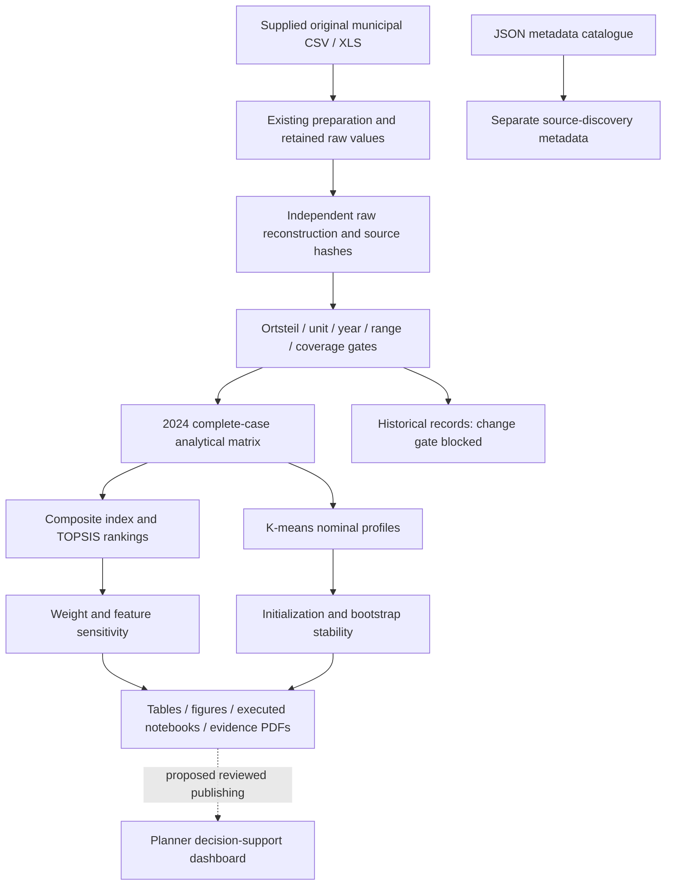

# Data flow and publication gates

The current pipeline reads local originals and verifies Phase 1 outputs without overwriting them. Selected observations retain source file/sheet, original indicator, block, geographic code, year, unit and raw value. A separate analytical matrix explicitly records exclusions. Normalization and TOPSIS trace tables allow score reconstruction. Publication is a proposed additional stage, requiring reference-date, licence, privacy and release approval checks.

Reproduction: python src/run_technical_pipeline.py runs audit, construction, descriptive analysis, scoring, clustering, robustness and packaging. python src/create_notebooks.py creates and executes eight notebooks from fresh kernels. python src/verify_outputs.py checks persisted results and immutable-source hashes. Source metadata cannot be filled in from guesswork.
