# Bremen Smart Governance · Part 2 architecture

This update extends the [Part 1 blueprint](../four_layer_architecture.md) and [data flow](../data_flow.md). The validated [2024-v1 release](releases/2024-v1/manifest.json) supplies the offline student dashboard and could serve as a versioned snapshot for a future municipal interface.

## Four layers

| Layer | Repository status | Municipal extension |
| --- | --- | --- |
| **1. Data acquisition** | **EXISTING** · Official Bremen statistical snapshots, archived boundary data, and a validated Ortsteil crosswalk. The integration takes saved, verified Part 1 and Part 2 outputs as analytical inputs. | **FUTURE** · Collect fieldwork observations after the team approves a protocol, scope, and handling of identifiable material. |
| **2. Transmission** | **EXISTING** · Local file exchange, with saved CSVs and other source snapshots in the repository. | **PROPOSED** · Retrieve new releases over HTTPS or a publisher-supported API when recurring updates are needed. Verify origin, snapshot version, and checksums before processing. |
| **3. Processing and storage** | **EXISTING** · Python preparation, validation, and saved analyses. **IMPLEMENTED** · [Read-only integration](integrate.py), which validates and assembles the release and records the source commit and hashes. | **PROPOSED** · Archive immutable releases in versioned municipal storage. Add a release catalogue or database when there is a demonstrated need to query multiple releases or serve concurrent users. |
| **4. Application and decision support** | **EXISTING** · Reports, evidence tables, figures, and executed notebooks. **IMPLEMENTED** · [Offline student dashboard](prototype/index.html) for read-only neighborhood comparison and release-level context. | **PROPOSED** · A municipal dashboard and a human-reviewed process for selecting, piloting, and evaluating interventions. |

**Status key.** EXISTING marks inherited sources, artifacts, and capabilities verified in the repository. IMPLEMENTED marks the Part 2 integration, validated release, and offline student dashboard. PROPOSED marks municipal components and workflows. FUTURE marks fieldwork that depends on approval and collection.

## Data flow and interpretation

Solid arrows show the repository evidence path. Dashed arrows show prospective handoffs. Editable sources are the [four-layer architecture](four_layer_architecture.mmd) and [data flow](data_flow.mmd) Mermaid files.

1. **Prepare the evidence.** The local preparation pipeline produces the annual panel and processed Atlas observations from municipal statistics. The archived boundary layers and [crosswalk](../../reports/section2_v2/atlas/geographic_join_validation.csv) support Meriam’s centroid-based spatial analysis. Saved Part 1 Composite Index, TOPSIS, and K-means results supply the analytical baseline. Meriam’s [verified 2024 analysis](../../notebooks/part2_data_analysis.ipynb) adds the housing benchmark, fieldwork shortlist, and global Moran’s I.
2. **Validate and publish a local release.** The integration reads the annual panel and saved analysis CSVs. It validates the inputs and keys on `(geo_code, year)`, retaining three-character codes. The [neighborhood table](releases/2024-v1/neighborhoods.csv) has 88 Ortsteile, 79 scored cases, and nine exclusions with reasons. It preserves separate ranking methods, nominal K-means profiles, housing benchmarks, and shortlist metadata. The manifest records input and output hashes. A failed check stops publication of the integration release.
3. **Read spatial results at release level.** The [spatial summary](releases/2024-v1/spatial_summary.csv) contains global Moran’s I for two spatial-weight settings over the 79 scored areas. Display it once per release and setting. It is a property of the scored sample and its spatial weights. Neighborhood rows carry the saved neighborhood-level results only.
4. **Build the offline student dashboard.** The [dashboard builder](build_dashboard.py) verifies both saved release CSVs against the manifest and checks the saved housing figure separately. It generates a single HTML file with neighborhood search, coverage and exclusion reasons, and a separate release-level spatial summary. See the [build and test instructions](README.md#offline-student-dashboard).

## Fieldwork and intervention review

All five shortlist entries are marked `proposed_not_visited`. The three recommended sites and two role-specific reserves were purposively selected to capture contrasts, method disagreement, or sensitivity. If visits are approved, use a common observation guide and record dates, conditions, and limitations. For example, observations about barriers to reaching a service could help reviewers judge whether local access warrants further investigation. Keep observations tied to the visit context and review the account with local stakeholders.

Reviewers would consider the shortlist, coverage gaps, service data, local feedback, and proposed changes together. If they approve a pilot, record the decision and define a baseline, success measure, review date, and feasible comparison before it starts. Use the evaluation to decide whether to adapt, stop, or extend it. Evidence about intervention effects would come from that evaluation.

## Quality and operation

| Consideration | Design decision |
| --- | --- |
| **Data quality** | Enforce schema, year, keys, coverage, finite values, exclusions, and consistency with saved results. Display reporting year and coverage before rankings. A future map must reuse the verified boundary crosswalk, including the documented Oberneuland exception. Historical comparisons require separate checks on definitions and boundaries. |
| **Provenance** | Keep immutable release IDs, source commit, input and output hashes, reporting periods, units, and method descriptions. Show boundary revision and attribution wherever geometry is published. |
| **Privacy** | Preserve source suppression and review possible disclosure and stigmatization before publishing small-area evidence. Restrict access to identifiable fieldwork material and publish only approved summaries. Set retention and deletion rules before collection. |
| **Transparency** | Show why excluded areas lack scores. Label the housing benchmark as a descriptive association and explain the scope of each method, including nominal profiles and the global spatial finding. Record the evidence and rationale behind pilot decisions. |
| **Accessibility** | Provide a keyboard-operable table and readable labels for missing values, coverage, and status. Offer a text table alongside any map, show the same information without relying on color, and provide accessible exports. |
| **Maintainability** | Reuse saved methods and the reproducible release contract. Document release ownership, review input changes against schema checks, and retain earlier versions so an interface can pin a validated release. |
| **Scalability** | Use the small static release as the starting point. Measure refresh time, output size, and interface response before adding infrastructure. Revisit storage and service design if release volume, retention, or concurrent use requires it. |
