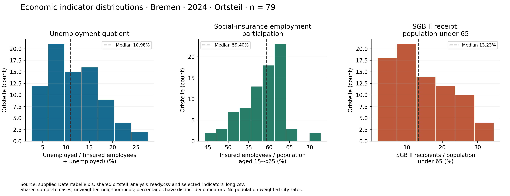
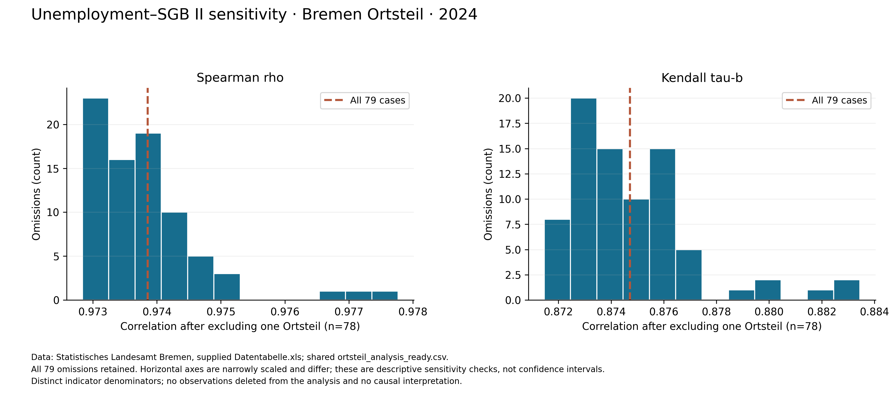
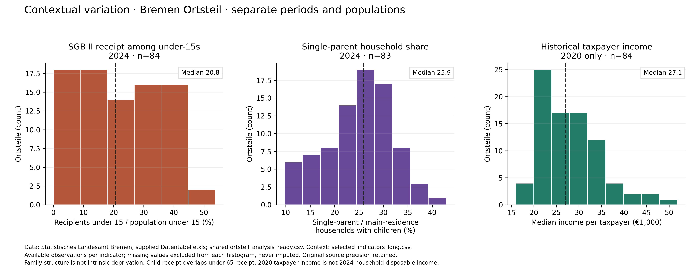
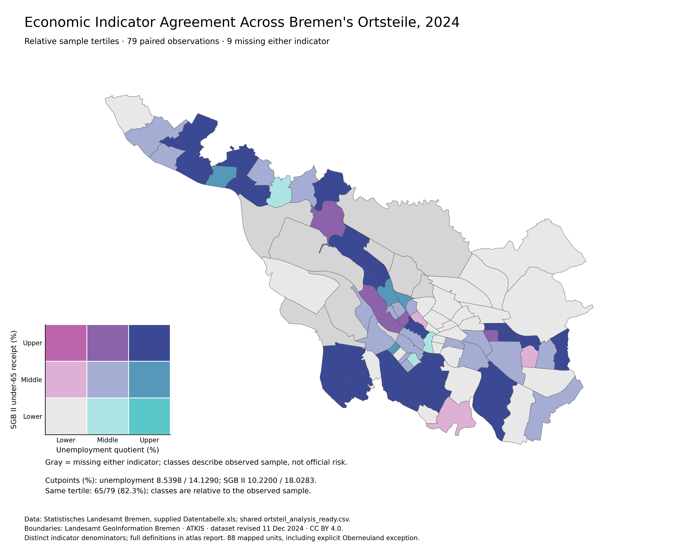
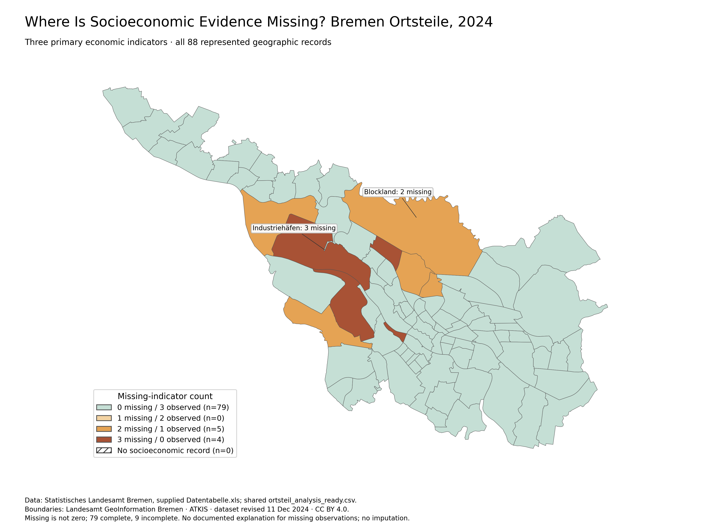
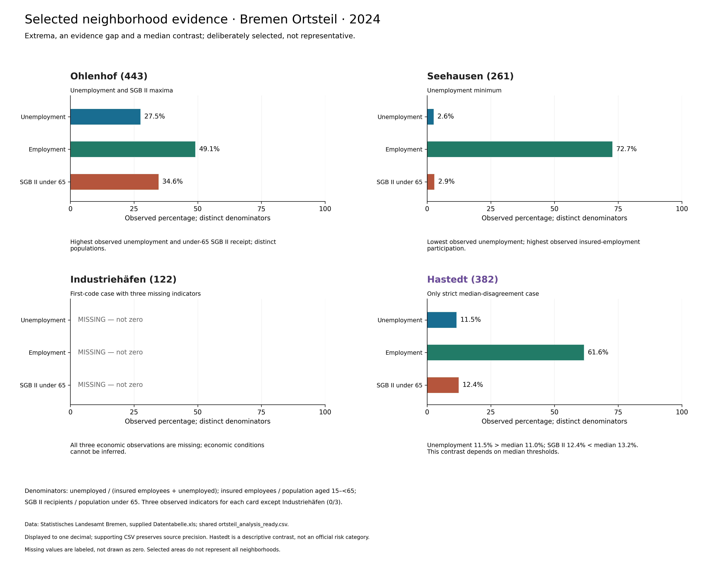

## 2.1 Data Sources and Geographic Coverage

Section 2 answers RQ1, **what socioeconomic and demographic differences exist across Bremen neighborhoods**, and RQ2, **which indicators are useful for identifying neighborhood disadvantage**. The evidence concerns 2024 observations, not current conditions. Input is the shared `data/processed/ortsteil_analysis_ready.csv` at commit `20b79ae817c5d7c7b80e1d93c79d415d47037be7`. Supplementary data come from `selected_indicators_long.csv`; definitions come from `analysis/indicator_selection.csv` and `analysis/data_dictionary.csv`.

All 88 represented statistical records remain in coverage documentation. The comparison sample comprises 79 Ortsteile with all three primary economic indicators. Codes remain strings. No missing observation is imputed. Exact German headings, units, reporting periods and all 9,152 selected workbook cells were reverified; 24 original-source hashes match. Descriptive statistics are unweighted neighborhood summaries, not population-weighted Bremen city rates.

Official boundaries are archived ATKIS Verwaltungsgrenzen from **Landesamt GeoInformation Bremen**, [CC BY 4.0](https://creativecommons.org/licenses/by/4.0/), EPSG:25832. [Official metadata](https://metaver.de/csw/partner/hb?Service=CSW&Request=GetRecordById&Version=2.0.2&id=D9F32B22-C647-42FD-9E95-1344AC57BC46&outputSchema=http://www.isotc211.org/2005/gmd&elementSetName=full) identifies a dataset revision of **11 December 2024**; access was 10 October 2026. A revision date is not proof of an exact legal validity day. The join matches 87 direct Ortsteil polygons and one explicitly documented undivided Oberneuland Stadtteil polygon to statistical code 361. All 88 records match; the three spelling differences remain documented. The separate overseas-port enclave and Bremerhaven are outside the represented mainland scope. Closed rings, coordinates, CRS and published areas were checked; no full topology certification is claimed.

## 2.2 Indicator Selection and Preprocessing

Unemployment is registered unemployed divided by insured employees plus unemployed; it is **not** the official all-civilian-labour-force unemployment rate. Employment participation covers socially insured employees at residence relative to population aged 15–<65, excluding employment outside social insurance. SGB II receipt covers recipients relative to population under 65, not all poverty or unmet benefit need. These different populations make percentages non-interchangeable.

Under-15 SGB II receipt is child-focused economic context and overlaps under-65 receipt. Single-parent share describes main-residence households with children and is **not intrinsic disadvantage**. Taxpayer income is a separate **2020** median in thousand EUR, not 2024 household disposable income. The available contextual indicators do not fully characterize demographic inequality.

Exact definitions and coverage:

**Unemployment quotient (%)** (2024; %; n=79/88). German source heading: Anteil der Arbeitslosen an den sozialversicherungspflichtig Beschäftigten zuzüglich Arbeitslose (%). Worksheet: Erwerbstätigkeit, Arbeitslosig, block 1. Registered unemployed / (social-insurance employees + registered unemployed). Not the official all-civilian-labour-force unemployment rate.

**Social-insurance employment (%)** (2024; %; n=79/88). German source heading: Anteil der sozialversicherungspflichtig Beschäftigten an der Bevölkerung im Alter von 15 bis unter 65 Jahren (%). Worksheet: Erwerbstätigkeit, Arbeitslosig, block 1. Social-insurance employees at residence / population aged 15 to under 65. Excludes self-employment and civil servants; low values are an imperfect labour-market disadvantage proxy.

**SGB II receipt, under 65 (%)** (2024; %; n=84/88). German source heading: Anteil der Leistungsberechtigten (Grundsicherung für Arbeitsuchende, SGB II) an der Bevölkerung unter 65 Jahren (%). Worksheet: Sozialleistungen, block 1. SGB II entitled recipients / population under 65. Measures receipt, not all poverty or unmet need; includes employed recipients.

**SGB II receipt, under 15 (%)** (2024; %; n=84/88). German source heading: Anteil der Leistungsberechtigten (Grundsicherung für Arbeitsuchende, SGB II) an der Bevölkerung unter 15 Jahren (%). Worksheet: Sozialleistungen, block 1. SGB II entitled recipients under 15 / population under 15. Overlaps overall benefit receipt; not independent evidence.

**Median income per taxpayer (1000 EUR)** (2020; 1000 EUR; n=84/88). German source heading: Gesamtbetrag der Einkünfte je Steuerpflichtigen (1000 EUR): Median. Worksheet: Lohn- und Einkommensteuer, block 1. Median total income per taxpayer, thousand EUR. Taxpayer unit differs from person/household; not disposable income. Latest year 2020.

**Single-parent households (%)** (2024; %; n=83/88). German source heading: Anteil der Alleinerziehenden an den Privathaushalten mit Hauptwohnsitz mit Kind(ern) (%). Worksheet: Privathaushalte, block 1. Single-parent households / main-residence households with children. Family structure is not intrinsic disadvantage; not scored.

| feature | reporting_year | valid_n | missing_n | missing_pct | role_recommendation |
| --- | --- | --- | --- | --- | --- |
| unemployment | 2024 | 79 | 9 | 10.2273 | Primary 2024 economic measure |
| employment | 2024 | 79 | 9 | 10.2273 | Primary 2024 economic measure |
| benefit_receipt | 2024 | 84 | 4 | 4.5455 | Primary 2024 economic measure |
| child_benefits | 2024 | 84 | 4 | 4.5455 | Supplementary 2024 child-focused economic context |
| income_median | 2020 | 84 | 4 | 4.5455 | Separate 2020 historical taxpayer-income context |
| single_parents | 2024 | 83 | 5 | 5.6818 | 2024 household-composition context; no intrinsic deprivation direction |

The qualitative suitability framework evaluates relevance, measurement scope, coverage, reference periods, traceability, redundancy and municipal interpretability separately. Empirical correlation is one source of overlap evidence, not a criterion that establishes validity or selects an objectively best indicator. Primary economic measures remain unemployment, employment participation and SGB II receipt; child receipt is supplementary, household composition contextual, and income historical. No numerical suitability scores or weights are assigned. Full assessment: `indicator_suitability_framework.csv`.

## 2.3 Neighborhood Differences, Indicator Relationships and Robustness

### Observed differences and distribution shapes

The following available-case results retain source precision in CSVs; displayed values are rounded. Sample SD uses ddof=1; quartiles/percentiles use linear interpolation. Adjusted Fisher–Pearson skewness is independently checked using central moments. Histograms support shape interpretation; skewness alone does not establish a distributional model.

| feature | year | n | mean | median | sd | iqr | adjusted_skewness |
| --- | --- | --- | --- | --- | --- | --- | --- |
| unemployment | 2024 | 79 | 11.8617 | 10.9762 | 5.5536 | 8.7611 | 0.5561 |
| employment | 2024 | 79 | 58.6303 | 59.4037 | 5.3129 | 6.5646 | -0.3848 |
| benefit_receipt | 2024 | 84 | 14.3292 | 12.4686 | 8.5705 | 13.5312 | 0.3347 |
| child_benefits | 2024 | 84 | 22.0805 | 20.7702 | 13.3109 | 21.2029 | 0.1500 |
| single_parents | 2024 | 83 | 24.9255 | 25.9427 | 6.8431 | 8.4847 | -0.2121 |
| income_median | 2020 | 84 | 28.0060 | 27.0980 | 7.0588 | 9.4970 | 0.8490 |

Unemployment ranges from Seehausen 2.5896% to Ohlenhof 27.5409%; SGB II receipt from In den Hufen 0.9901% to Ohlenhof 34.6216%. Employment ranges from Fähr-Lobbendorf 44.1589% to Seehausen 72.7138%. These are observed economic contrasts; neither individual need nor causes can be inferred.



The exploratory Tukey rule flags values below Q1−1.5×IQR or above Q3+1.5×IQR, strictly outside the fences. Employment flags Rablinghausen, Seehausen, Grohn and Fähr-Lobbendorf. Unemployment and under-65 SGB II have no such flags. Hohweg is flagged for single-parent share, and Borgfeld for historical income. All flagged/extreme cells were reverified in the original workbook and retained. Flags are not errors or neighborhood risk labels. Source review and both sample-specific rules are in `source_verified_extremes.csv`.

### Rank relationships and omission sensitivity

| first | second | n | spearman_rho | kendall_tau_b |
| --- | --- | --- | --- | --- |
| unemployment | employment | 79 | -0.6674 | -0.4937 |
| unemployment | benefit_receipt | 79 | 0.9739 | 0.8747 |
| employment | benefit_receipt | 79 | -0.5879 | -0.4281 |

Each primary pairwise sample contains the **same 79 codes** as the complete-case sample, so pairwise correlations do not recover additional evidence. Spearman is checked against rank covariance; Kendall tau-b is checked independently using all concordant/discordant pairs with tie-adjusted denominator. No tied primary values occur here; the implementation and tests still handle ties. [SciPy's Kendall tau-b definition](https://docs.scipy.org/doc/scipy/reference/generated/scipy.stats.kendalltau.html) documents the variant. P-values are not used to turn a descriptive observed-area comparison into a random-sample inference.

The unemployment–SGB II relationship has rho=0.9738558909 and tau-b=0.8747160013, n=79. Across all 79 single-neighborhood omissions (n=78 each), rho spans **0.9728372893–0.9777690664** and tau-b **0.8714618715–0.8834498834**. The largest absolute rho change is **0.0039131754**, excluding Fähr-Lobbendorf. The strong positive monotonic association persists under every single omission; this does not address simultaneous omissions, definition changes, population weights or unobserved areas.

Eight observations meet the reproducible exploratory sensitivity criterion |delta rho|≥the sample 90th percentile (0.0009781358). This is an operational review flag, not a significance test or proof of statistical influence. All observations remain in the baseline analysis:

| excluded_geo_code | excluded_geo_name | spearman_rho | delta_rho | delta_tau_b |
| --- | --- | --- | --- | --- |
| 525 | Fähr-Lobbendorf | 0.9778 | 0.0039 | 0.0087 |
| 515 | St. Magnus | 0.9771 | 0.0033 | 0.0081 |
| 431 | Utbremen | 0.9767 | 0.0028 | 0.0074 |
| 334 | Neue Vahr Südwest | 0.9752 | 0.0014 | 0.0047 |
| 217 | Neuenland | 0.9750 | 0.0012 | 0.0047 |
| 371 | Ellener Feld | 0.9750 | 0.0012 | 0.0041 |
| 442 | Gröpelingen | 0.9728 | -0.0010 | -0.0033 |
| 443 | Ohlenhof | 0.9728 | -0.0010 | -0.0033 |



All available/complete-case descriptive leave-one-out values and their mean/median/SD/IQR ranges are exported. This checks whether a single case changes summaries without deleting valid observations or changing source data.

### Missingness sensitivity

| feature | available_n | complete_n | available_mean | complete_mean | mean_difference_pp |
| --- | --- | --- | --- | --- | --- |
| unemployment | 79 | 79 | 11.8617 | 11.8617 | 0.0000 |
| employment | 79 | 79 | 58.6303 | 58.6303 | 0.0000 |
| benefit_receipt | 84 | 79 | 14.3292 | 14.8438 | 0.5146 |

Unemployment and employment use identical available and complete samples. Restricting SGB II from 84 to 79 raises its mean by **0.514646 percentage points**, median by **0.763750 points**, reduces SD by 0.178082 points and IQR by 1.303150 points. The minimum changes from In den Hufen to Borgfeld; the maximum remains Ohlenhof. Thus broad observed variation persists but numerical summaries and extrema depend on sample restriction. No missing-at-random assumption or correction for selection bias is made.

### Contextual variation and exploratory association

Child SGB II receipt has 84 observations, mean 22.0805%, median 20.7702%, range 0.0000% (In den Hufen)–53.6825% (Bahnhofsvorstadt). The genuine zero is preserved; blanks are not treated as zero. Single-parent share has 83 observations, mean 24.9255%, median 25.9427%, range 9.7561% (Blockland)–42.8571% (Hohweg). Historical taxpayer income has 84 observations in 2020, mean 28.0060 and median 27.0980 thousand EUR, range 16.0030 (Lindenhof)–51.8630 (Borgfeld). Income is described separately, with no mixed-year association presented as 2024.

| context | primary | year | n | spearman_rho | kendall_tau_b |
| --- | --- | --- | --- | --- | --- |
| child_benefits | unemployment | 2024 | 79 | 0.9437 | 0.7936 |
| child_benefits | employment | 2024 | 79 | -0.5763 | -0.4145 |
| child_benefits | benefit_receipt | 2024 | 84 | 0.9737 | 0.8589 |
| single_parents | unemployment | 2024 | 79 | 0.8084 | 0.6254 |
| single_parents | employment | 2024 | 79 | -0.4449 | -0.3242 |
| single_parents | benefit_receipt | 2024 | 83 | 0.7825 | 0.6004 |

Under-15 and under-65 receipt share a population component and a benefit-system concept. Their available matched correlation uses n=84, unlike the preserved V2 n=79 result. This strong relationship does not supply independent corroboration. Household-structure associations are ecological and cannot justify an intrinsic-deprivation interpretation or distinguish selection from other mechanisms. These are exploratory comparisons without causal claims or confirmatory multiple-test inference.



## 2.4 Atlas Evidence and Smart-Governance Implications

Redesigned maps keep the original geographic join, data values, extents and fixed 5-percentage-point classes (0–35% for unemployment/SGB II). The perceptually ordered cividis palette is reversed so higher numerical rates are darker. Gray denotes missing. This color ordering describes indicator values, not an official deprivation classification. Land area is not affected population.


The bivariate map preserves original sample tertiles and assignments. Unemployment cutpoints are 8.5398%/14.1290%; SGB II 10.2200%/18.0283%. Values exactly on boundaries go to the lower class; each marginal has group sizes 27/26/26. Of 79 paired observations, 65 (82.28%) occupy the same tertile and 14 differ. These sample-relative categories are not official socioeconomic risk groups, a composite score or evidence of formal spatial clustering.



The missingness map retains 79 complete areas, five missing two economic indicators and four missing all three. None lack exactly one; no selected geometry lacks a socioeconomic row. Missingness explanations are unknown. Hiding excluded units from decision support would conceal evidence gaps, but neither affected population nor allocation consequences are estimated.



Cards retain the atlas's purposive selection: Ohlenhof (coincident maxima), Seehausen (unemployment minimum), Industriehäfen (first-code wholly missing case), and Hastedt (only strict median-disagreement case). Hastedt is above the unemployment median and below the SGB II median, but remains in the middle tertile of both; disagreement depends on thresholds. Percentages display to one decimal while CSV precision is unchanged. These examples are not representative or officially classified.



The offline `evidence_explorer.html` exposes selectable primary indicators, 88 original-coordinate polygons, definitions, values, missingness and geography caveats without external tiles, scripts or network data. It is a research prototype, not a deployed municipal service. Keyboard focus, a neighborhood selector and browser-tested events support access. No universal color-vision or WCAG certification is claimed.

## 2.5 Limitations and Handover

RQ1 is answered by the documented differences and coverage gaps; the two contextual indicators do not constitute a comprehensive demographic inequality assessment. RQ2 supports the three economic measures within their restricted definitions, distinguishes demographic context and historical income, and flags strong overlap. Suitability rests on substantive scope and traceability, not correlation alone.

Exact statistical reference dates, denominator counts, full municipal definitions and legal boundary-validity day remain unresolved. Geographic compatibility is documented annually, not certified historically. Missingness reasons are unknown. Rates are ecological and unweighted; there are no causal, individual-poverty, random-sample or current-2026 claims. Omission sensitivity checks a limited perturbation, not all robustness threats. No composite index, TOPSIS, clustering, method-agreement metric or deprivation ranking is implemented.

Section 1 can use verified contrasts for framing. Section 3 can use definitions, provenance, exclusions and geographic caveats for transparent decision support. Section 4 receives unchanged primary values and overlap warnings; its weighting, normalization, composite methods and comparative-method assessment remain separate. Existing validated artifacts are preserved; new manifests and audit findings are additive.

Reproduce from repository root:

```powershell
.\.venv-section2\Scripts\python.exe -B src\section2_enhanced\build_enhancement.py
```

No new packages are required. All figures have PNG/PDF/SVG versions, with deterministic export metadata. Quarto rendering and browser checks run in temporary isolated directories. Offline reproduction depends on the archived authoritative inputs and polygons. Original generator inventories can reject a new full rerun after additive files appear; their frozen evidence remains verified unchanged. The enhanced pipeline has an independent manifest and collision guard.
